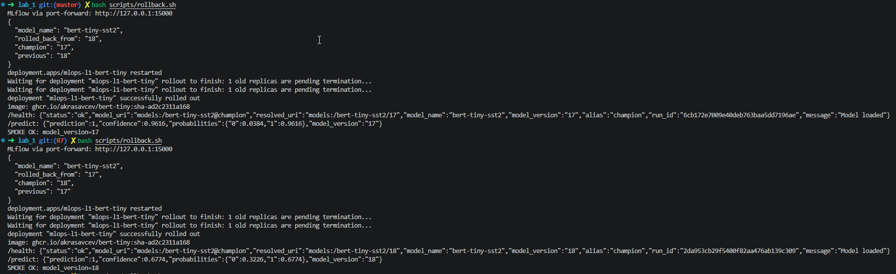

# Ataskaita

## Kas padaryta

* **U2-R1** - Padaryta
* **U2-R2** - Padaryta
* **U2-R3** - Padaryta
* **U2-R4** - Padaryta
* **U2-R5** - Padaryta
* **U2-R6** - Padaryta
* **U2-R7** - Padaryta

Išplestinė dalis (**E1-E5**) nebuvo implementuota.

Implementuotas modelio apmokymo pipeline'as: 
test -> build -> push to ghcr -> train(download -> prepare -> train -> evaluate) -> register on threshhold -> deploy

* **Test** etape naudojami *ruff* ir *pytest*. 
* **Build** etapas vyksta GitHub'o runner'yje. Juo metu build'iname inference ir train image'us, publikuojame juos i GHCR. 
* **Train** etapas susideda is 4 subetapu:
    * **Download** atsiuncia dataset'a is HuggingFace
    * **Prepare** sukuria train ir test datasetus
    * **Train** treniruoja modeli
    * **Evaluate** evaluate'ina modeli
* **Register** etapas registruoja modeli MLflow serveryje, jeigu nustatyta metrika pasiekia threshold'a (metrika ir threshold'as nustatomi [params.yaml](../params.yaml) faile)
* **Deploy** etapas deploy'ina apmokyta modeli musu minikube klasteryje, jeigu **Register** etapas buvo ivykdytas sekmingai

Taip pat implementuoti *HPO* su **Optuna** ir *rollback* scenarijus. Hyperparametru sarasas yra saugomas [params.yaml](../params.yaml) faile. *Rollback* yra iskvieciamas automatiskai jeigu **CD** metu fail'ina deploy arba smoke testas

## Architektura: 
```
                 GitHub                                   Local machine (WSL / Linux)
 ┌──────────────────────────────────┐        ┌────────────────────────────────────────────────────────┐
 │ push / PR                        │        │  Minikube cluster, namespace mlops-l1                  │
 │   │                              │        │                                                        │
 │   ▼                              │        │   ┌────────────┐     ┌─────────────────────────────┐   │
 │ CI (GitHub-hosted runner)        │        │   │ postgres   │◄────┤ mlflow (tracking + registry)│   │
 │   ruff + pytest                  │        │   │ (PVC)      │     │ :5000, NodePort 30500 (PVC) │   │
 │   build + push images ──► GHCR ──┼──pull──┼─┐ └────────────┘     └──────▲─────────▲────────────┘   │
 │   │ (master only)                │        │ │                           │ log     │ download       │
 │   ▼                              │        │ │  ┌──────────────────────┐ │         │ @champion      │
 │ CD (self-hosted runner) ─────────┼────────┼─┼─►│ Job bert-tiny-train  ├─┘         │                │
 │   train Job → quality gate       │        │ │  └──────────────────────┘ ┌─────────┴────────────┐   │
 │   → register @champion           │        │ └──────────────────────────►│ Deployment           │   │
 │   → deploy → smoke test          │        │                             │ mlops-l1-bert-tiny   │   │
 │   → auto-rollback on failure     │        │                             │ FastAPI :8000        │   │
 └──────────────────────────────────┘        │                             └──────────────────────┘   │
                                             └────────────────────────────────────────────────────────┘
```

## Load testas

Paskutinio load testo rezultatai

Generated by `scripts/load_test.sh` (`scripts/load_test.py`): `POST /predict` through `kubectl port-forward` to the `mlops-l1-bert-tiny` Service, one pod (limit 1 CPU / 1Gi). Latency is measured on the client, so it includes the port-forward hop.

```json
{
  "timestamp": "2026-11-09T14:00:24+00:00",
  "url": "http://localhost:8000",
  "requests": 500,
  "concurrency": 10,
  "warmup": 10,
  "model_name": "bert-tiny-sst2",
  "model_version": "17",
  "run_id": "6cb172e7009e40deb763baa5dd7196ae",
  "successful": 500,
  "error_rate": 0.0,
  "errors": {},
  "wall_time_s": 6.72,
  "throughput_rps": 74.4,
  "latency_ms": {
    "mean": 134.2,
    "min": 5.5,
    "p50": 115.0,
    "p95": 183.3,
    "p99": 217.6,
    "max": 228.4
  },
  "meta": {
    "image": "`ghcr.io/akrasavcev/bert-tiny:sha-56a40cb4c8f9`",
    "image_size": "386 MB (uncompressed)",
    "model_artifact_size": "18 MB (MLflow artifact, downloaded at start)",
    "cold_start": "6.4 s (rollout restart -> pod Ready, incl. model download)"
  }
}
```

## Rollback pavyzdys

MLflow serveryje esanciu modeliu 2 paskutines versijos: *17* ir *18*

Paleidus scripta [rollback.sh](../scripts/rollback.sh), 17 versija taps *@champion*, o 18 - *@previous*. Paleidus ji dar karta, versijos igis ankstesnes reiksmes. Kiekvieno rollback'o metu inference deploymentas yra restartinamas

